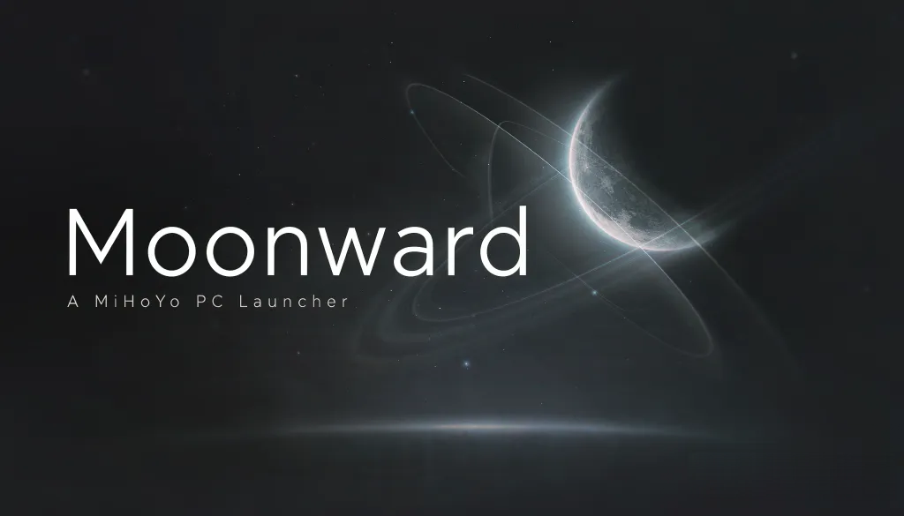

  

  An open-source third-party launcher based on <a href="https://github.com/Scighost/Starward">Starward</a>, for miHoYo PC games 
  <a href="https://github.com/TurmoilZoom/Moonward/releases/latest">Download</a>

  <a href="../README.md">简体中文</a>
  · <a href="README.zh-TW.md">繁體中文</a>
  · English
  · <a href="README.de-DE.md">Deutsch</a>
  · <a href="README.es-ES.md">Español</a>
  · <a href="README.it-IT.md">Italiano</a>
  · <a href="README.ja-JP.md">日本語</a>
  · <a href="README.ko-KR.md">한국어</a>
  · <a href="README.ru-RU.md">Русский</a>
  · <a href="README.th-TH.md">ไทย</a>
  · <a href="README.vi-VN.md">Tiếng Việt</a>

---

On top of upstream Starward, everyday actions are packed into a desktop shortcut and a single URL, with extras for gacha, battle records, game installation, backgrounds and more. Highlights:

#### Gacha

- **Wish / gacha history** — Banner stats can be drag-reordered and stick to the top. Switch between a list view and a compact icon grid. UP / miss streaks and 50/50 win rate are easy to see
- **Filter & share** — Title-bar dropdown chooses which banners to show, with select all / invert / reset. One click makes a frosted share image with pity count and guarantee progress
- **Gacha sync** — Genshin Impact (China) and Zenless Zone Zero can sync records from miHoYo BBS; Zenless Zone Zero also supports HoYoLAB. New items not yet in the catalog get icons and names filled in automatically. Item names follow the app language
- **Miliastra Wonderland** — The wish history page works like the gacha history page (filter, compact view, drag reorder, share image), and item icons missing upstream are filled in
- **UIGF** — Import / export gacha records as UIGF

#### Battle records & toolbox

- **Daily check-in** — miHoYo BBS / HoYoLAB check-in, per-game toggles, auto check-in and makeup check-in. While resident in the tray, it checks in again after each daily reset
- **Login** — China servers use a phone SMS code; overseas servers use web login. Expired sessions are renewed automatically when possible, so you don't have to log in again and again
- **Auto-refresh records** — Set a refresh frequency per account and data section (including the current and previous month of monthly reports); records refresh automatically when the app starts
- **Monthly reports & notes** — Toolbox monthly reports (Trailblaze Monthly Calendar / Inter-Knot Monthly Report / Traveler's Diary) share one layout. The Inter-Knot report counts daily data in the server's time zone and defaults to the current month. Genshin real-time notes show more details. A verification entry is offered when risk control kicks in
- **Record display** — Battle records and monthly reports can be exported as share images. Imaginarium Theater marks trial and support characters; Anomaly Arbitration shows quick clears and difficulty names
- **Cloud gaming** — See remaining play time for Cloud Genshin and Cloud Zenless Zone Zero, and claim the daily free time automatically

#### Launch

- **Multiple launch profiles** — Unlimited sets of launch arguments and custom launchers per game. Each profile has its own DX12 argument and "launch via CMD" settings; name a profile and create a desktop shortcut
- **Third-party tools** — A custom launcher can also be a URL protocol link. Common command-line arguments include groups for BetterGI, ZZZ OneDragon and March7th Assistant
- **URL protocol** — `moonward://` starts / stops / restarts a given game, profile, and account, or runs check-in alone. Embeddable in scripts or web pages (see [docs/UrlProtocol](UrlProtocol.md))
- **Quick launch** — Home hamburger menu combines game settings, quick launch, and game shortcuts. Shortcuts can skip the UAC prompt, and the related scheduled tasks can be managed per game in Settings
- **Playtime** — A timer appears on the Start Game button while the game runs. Playtime statistics can switch games, pick a year and month, and make a share image. Time the PC spends asleep is not counted

#### Installation & updates

- **Hard-linked servers** — Updating or repairing a game also handles other servers that share its files through hard links (the base install is always updated first). The uninstall dialog lists every installed server of the same game and can remove them together
- **Install options** — Zenless Zone Zero can install full or base resources. The install path shows the disk type (SSD / HDD / removable / network). Chunk downloads run in parallel by chunk
- **Repair & version info** — Repair is now a dedicated dialog that can also repair the Miliastra Sandbox on its own, with verification threads tuned to the disk type. The Version info page in game settings lists the version, incremental patches and the main executable's MD5. Auto-detect can find games installed inside the app (including hard links)

#### Look & background

- **Trust wallpapers** — In Zenless Zone Zero, wiki Trust motion wallpapers and Mindscape still wallpapers can be downloaded and set as a custom background. Shuffle mode picks a new one on startup, when switching games, or when opening from the tray. Opening the gallery uses the local cache; updates are checked silently in the background
- **Custom background** — Dedicated dialog for image / video (drag onto the home page to replace). Poster choice is kept after the background list updates
- **Video backgrounds** — Videos that can't be hardware-decoded are transcoded to H.264 automatically. If the HEVC / VP9 extension is missing, the app guides you to install it or shows a still image instead. Decoding is released while the display is off, so it no longer burns CPU
- **Home toolbar** — Event timeline (banner / event countdowns), China-server livestream redeem codes, and interactive maps (Genshin Impact / Honkai: Star Rail)

#### Other

- **Tray residency** — Optional start at login into the tray. Global hotkeys and gamepad control keep working while resident; the tray menu can toggle them and check for updates
- **LAN sync** — Pull gacha records, toolbox data and playtime from another device on the local network. Only records missing on this PC are added; login credentials are never synced
- **Data management** — Database, cache, logs and backgrounds live under one folder of your choice. Settings can back up the database and clear the cache. On first launch you can import data from upstream Starward (read-only; the original data is untouched)
- **Feedback** — The About page pre-fills environment info in one click, opens the GitHub issue page, and opens the log folder
- **Silent updates** — New versions download in the background (also checked periodically while resident in the tray) and install when you quit or on the next launch, without interrupting a game whose playtime is being recorded. The changelog is shown after installation. Update packages come from CNB first and fall back to GitHub (Velopack)

Installers are on [GitHub Releases](https://github.com/TurmoilZoom/Moonward/releases); users in mainland China can also download from [CNB](https://cnb.cool/TurmoilZoom/Moonward/-/releases).

Upstream: [Scighost/Starward](https://github.com/Scighost/Starward)  
Credits: [CREDITS.md](../CREDITS.md) (open-source projects referenced for features and design)  
License: [MIT](../LICENSE)

Privacy: [docs/Privacy.md](Privacy.md)
